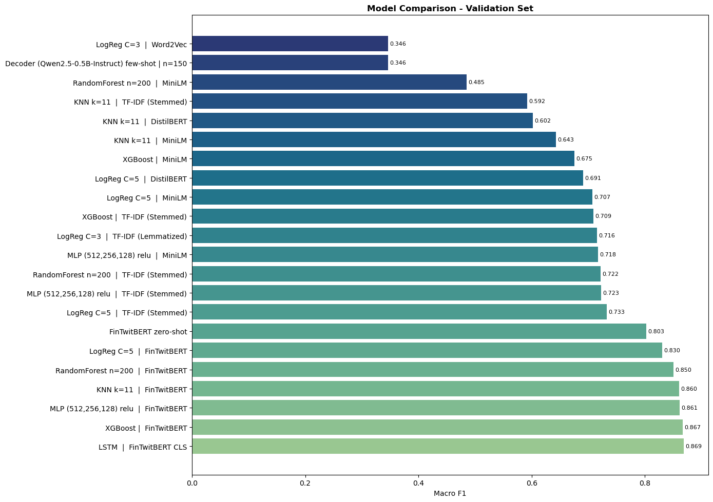
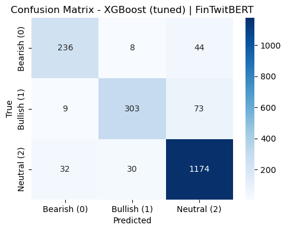

# Market Sentiment from Financial Tweets

Classifying financial tweets as **Bearish**, **Bullish** or **Neutral**. The project compares 22 combinations of text representation and classifier, from TF-IDF with logistic regression to finance-specific transformer embeddings and a few-shot LLM, and finds that the representation matters far more than the model.

Built with a partner for the Text Mining course of the MSc in Data Science and Advanced Analytics at NOVA IMS (2025/26). Course grade: **19/20**.

## Results

About 65% of the tweets are Neutral, so a model that always answers "Neutral" would already score roughly 65% accuracy. Models are therefore ranked by **macro-F1**, which weights the three classes equally, on a stratified 20% validation split (1,909 tweets).



| Model                                      | Features               | Accuracy  | Macro-F1  |
| ------------------------------------------ | ---------------------- | --------- | --------- |
| LSTM                                       | FinTwitBERT embeddings | 0.898     | 0.869     |
| XGBoost                                    | FinTwitBERT embeddings | 0.898     | 0.867     |
| **XGBoost, tuned (final model)**           | FinTwitBERT embeddings | **0.900** | **0.866** |
| MLP                                        | FinTwitBERT embeddings | 0.892     | 0.861     |
| k-NN (k = 11)                              | FinTwitBERT embeddings | 0.890     | 0.860     |
| FinTwitBERT zero-shot head                 | —                      | 0.827     | 0.803     |
| Logistic regression (best non-transformer) | TF-IDF, stemmed        | 0.814     | 0.733     |
| Qwen2.5-0.5B-Instruct, few-shot            | —                      | —         | 0.346     |

**What the numbers say**

- **Representation beats model choice.** The same k-NN goes from 0.592 macro-F1 on TF-IDF to 0.860 on FinTwitBERT embeddings. Every classifier's best result uses FinTwitBERT, an encoder trained on financial tweets.
- **The top five models are within 0.01 of each other**, so the final choice (tuned XGBoost, 0.875 macro-F1 in cross-validation, 0.866 on validation) is about as good as any of them.
- **The model rarely confuses the two opinions.** Its mistakes are almost all opinionated tweets read as Neutral (44 Bearish and 73 Bullish), while Bearish and Bullish are swapped only 17 times out of 673.
- **The small LLM did poorly** because CPU-only hardware limited us to a 0.5B-parameter model, prompted (not trained) on a 150-tweet sample.



## Approach

1. **Exploration:** class balance, tweet length, frequent words and word clouds per class.
2. **Preprocessing:** regular expressions turn tickers, prices, signed percentages, links, mentions, dates and times into placeholder tokens (`>stock`, `>cost`, `>positivenum`, `>link`, …), keeping the fact that something was mentioned without memorising the value. Stemming and stop-word removal are used only for the bag-of-words features; transformers get lightly cleaned, natural text.
3. **Features:** TF-IDF (stemmed and lemmatized), Word2Vec trained on the corpus, and frozen [CLS] embeddings from DistilBERT, MiniLM and [FinTwitBERT](https://huggingface.co/StephanAkkerman/FinTwitBERT-sentiment).
4. **Models:** k-NN, logistic regression, random forest, MLP, XGBoost, an LSTM, FinTwitBERT's built-in sentiment head (zero-shot), and a few-shot decoder LLM.
5. **Final model:** XGBoost on FinTwitBERT embeddings, tuned with a randomized search and used to label the test set.

## Repository

| Path                             | Contents                                                                       |
| -------------------------------- | ------------------------------------------------------------------------------ |
| `notebooks/01_experiments.ipynb` | Exploration, preprocessing, all feature sets and models, comparison and tuning |
| `notebooks/02_final_model.ipynb` | Short, ready-to-run pipeline for the final model only                          |
| `predictions.csv`                | The final model's labels for the 2,388 test tweets                             |
| `data/`                          | `train.csv` (9,543 labelled tweets) and `test.csv` (2,388 unlabelled tweets)   |

## Running it

```bash
pip install -r requirements.txt
cd notebooks
jupyter notebook 02_final_model.ipynb
```

The data is included in `data/`. The transformer models download from Hugging Face on first run. Everything runs on CPU; encoding the tweets with FinTwitBERT takes a few minutes.
